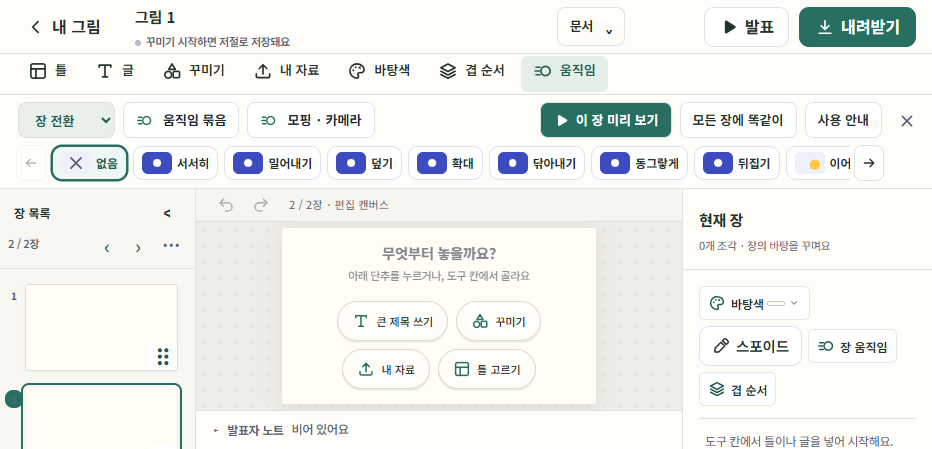
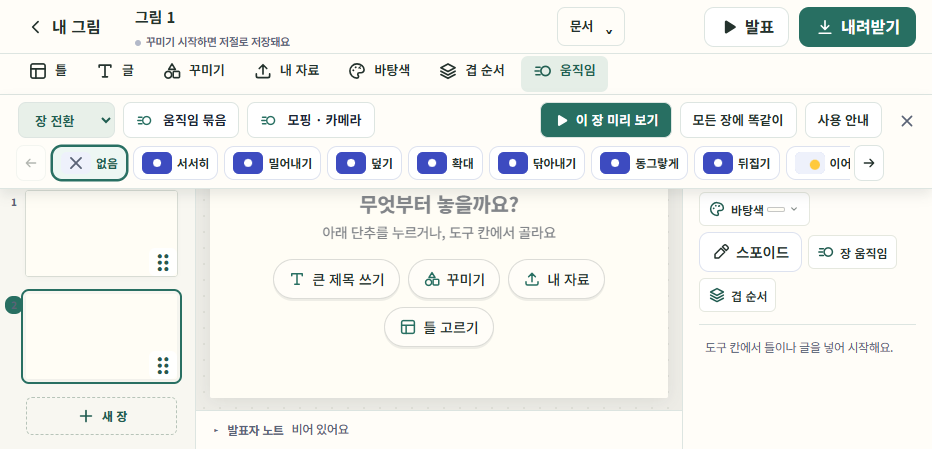

# 온바탕 · 장 중심 편집기 V2 첫 구현 · 2026-11-02

**최신 변경** · [장 위에 겹치는 도구 메뉴](#장-위에-겹치는-도구-메뉴)에서 운영 버전과 검수 결과를 확인한다. 16:9 기본 장과 가로 선택지의 도입 기록은 [직전 배포](#16대9와-가로-도구-메뉴)에 있다.

온바탕 편집기의 상단·장 목록·캔버스·속성을 장 중심으로 개편했다. 기존 PPT 수정과 새 자료 제작을 같은 비중으로 지원한다. 제품 버전은 온바탕 **0.117.0**, 가이랩 **0.171.0**이다. 운영 주소와 머지 커밋은 [11월 3일 운영 배포 기록](#운영-배포)에서 확인한다.

## 구현한 화면

| 영역 | 실제 동작 | 유지한 기능 |
| --- | --- | --- |
| 상단 | 제목·실제 저장 상태·문서 메뉴·발표·내려받기 | 문서 메뉴 안에 버전 기록, 비율, 공동 편집, 도움말과 호스트가 제공하는 공유·계정·자료 저장·수업 진입을 그대로 연결 |
| 왼쪽 장 목록 | 세로 미리보기, 선택 장 표시, 순서 끌기, Alt+↑/↓, 접기, 너비 조절 | 새 장·복제·삭제·이동·활동·퀴즈·결과 가져오기·장 문맥 메뉴, 여러 파트 PPT의 전체 순서 |
| 가운데 | 실행 취소/다시 실행, 장 번호, 화면에 맞는 캔버스, 발표자 노트 | 캔버스 직접 편집, 바깥에서 시작하는 선택, 기존 저장/실행 취소/발표/출력 엔진 |
| 오른쪽 | 현재 장 또는 선택한 글·사진·도형·복수 선택·잠금 상태에 따른 속성 | 글꼴·서식·색·사진 자르기·효과·위치·정렬·복제·잠금 등 기존 도구를 같은 DOM과 핸들러로 연결 |
| 도구 진입 | 상단 틀·글·꾸미기·내 자료·바탕색·겹 순서·움직임 → 필요한 칸을 펼침 | 7개 도구의 내용과 기능을 유지. 선택 속성을 펼쳐도 삽입 도구를 강제로 열지 않음 |
| 작은 화면 | 장 목록/속성 버튼으로 각각 열기. 도구 칸 닫기·Escape·캔버스 클릭으로 복귀 | 작은 화면에서 조각을 넣으면 도구 칸이 접히고 바로 글을 편집. 호스트 홈과 임베드 완료/닫기 유지 |

9종 출력 형식과 이전 오프라인 HTML 모핑을 유지했다. 데이터 스키마·원본 PPT·저장소를 이전하지 않는다. 높이를 조절하던 하단 목록은 왼쪽 목록의 너비 조절로 바뀌었으며, 새 기기 설정 키 `onbatang.page-rail.v2.<storage>`에만 접기·너비를 기억한다.

## 코드와 연결 계약

- `app/editor-workspace.js`: 문서 메뉴와 도구/장/속성 열기·닫기. AbortController로 이벤트를 정리한다. 저장 데이터나 편집 명령을 소유하지 않는다.
- `app/app.js`: 실제 앱 배치, 문서별 호스트 동작, 세로 목록 스크롤, 전체 PPT 순서, 인라인 가져오기 가드. 새 장 목록/속성도 가져오기 중 전환 보호 대상이다. 편집기를 떠날 때 workspace와 rail을 해제한다.
- `app/filmstrip.js`: 기존 수평 정렬을 유지하면서 `vertical` 옵션을 추가. 앱은 `bindPageRail`로 세로 스크롤·드래그·키보드 정렬·152~300px 너비와 접기를 제어한다. 기존 가로용 바인더를 호출하는 다른 소비자는 영향을 받지 않는다.
- `src/editor.js`: 선택 속성 제목과 분리된 `historyTools`는 `inspector:true`일 때만 켜진다. 기본 모듈 배치/API는 유지한다. `onToolOpen/onToolClose/onInsert`는 화면 배치용 선택 콜백이다.
- `app/app.css`: `.cv-page-workspace` 아래에 새 배치를 한정한다. 900px 이상은 3열, 그 아래는 캔버스 위로 여는 패널이다. `app/tour.js`의 위치 설명과 앵커도 실제 배치에 맞췄다.
- `app/pptx-import/vendor/BUILD.json`: package-lock 버전 변경 후 공식 생성 도구로 맞췄다. PPT 렌더러 버전은 바꾸지 않았다.

도구의 DOM을 복제하지 않았다. 글 부분 서식, 사진 자르기의 포인터/포커스, 공동 편집 잠금, 실행 취소 이력을 기존 엔진에서 처리한다. 공용에서 제공하지 않는 호스트 기능을 새로 노출하지 않는다.

## 검증 기록

- 공용 단위 검사 `npm test`: 412개 통과.
- 새 `tests/browser/page-workspace.test.mjs`: Edge 2개, Windows WebKit 2개 통과. 글 수정·굵게·취소/다시 실행·복수 선택/그룹·사진 자르기 진입/취소·잠금 해제·삽입·세로 드래그·키보드 순서 변경·새 장·목록 접기/너비·노트·발표·9종 출력 진입·저장/재열기를 확인했다.
- 1440×1000, 1024×768, 768/390/320×844에서 영역 배치·캔버스 접근·패널 열기/닫기·가로 넘침을 확인했다. 실제 iOS 키보드·Safari 검수와 같지 않다.
- Edge 기존 회귀: 임베드 PNG/원본 반환, 호스트 이동 전 저장/실패 보호, 글 부분 서식, 사진 crop, 인라인 PPT의 취소/거절/부분 저장/재시도/원본 불변, 계정 목록, 공유, 버전 이력 복원, 공동 편집·잠금·종료, 원본 PPT 비율, 새로고침 복구, 사용법 안내, 모핑·카메라 직접 편집을 확인했다.
- 오프라인 HTML 모핑 2개는 Edge와 WebKit에서 각각 통과했다. 역방향·빠른 이동·활동 결과·재다운로드·손상된 레이어 fallback을 포함한다.
- 기존 UI의 버튼이 문서 메뉴/도구 칸 안으로 이동한 테스트는 사용자가 새 메뉴를 여는 경로로 갱신했다. 기능 assertion을 제거하지 않았다.

로컬 캡처/로그는 Git 제외 폴더 `work/page-workspace-qa/`, `work/v2-workspace-new.log`, `work/v2-webkit.log`, `work/v2-regression.log`, `work/v2-workspace.log`, `work/v2-menus.log`에 있다. 초기 로그에는 옛 위치를 직접 누르는 테스트 실패가 남아 있으며 메뉴 경로를 수정한 재실행 결과와 구별한다.

재현: `MINICAN_PLAYWRIGHT_PATH`에 설치된 Playwright 모듈 절대 경로를 넣고 `node --test --test-concurrency=1 tests/browser/page-workspace.test.mjs`를 실행한다. WebKit은 `MINICAN_BROWSER=webkit`과 `PLAYWRIGHT_BROWSERS_PATH`를 지정한다. `MINICAN_HOST_ROOT`를 가이랩 `dist`로 지정하면 그 내장 소스로 같은 시나리오를 실행한다.

## 미리보기 검증 · 2026-11-02

양쪽 작업 브랜치는 `codex/onbatang-v2-ui-20261102`다. 아래 표는 11월 2일 미리보기 검증 기준이다. 11월 3일의 머지 커밋과 운영 확인 결과는 [운영 배포](#운영-배포)에 기록했다. 이전 버전의 자료는 [0.116.0 오프라인 모핑 인수인계](ONBATANG_HANDOFF_2026-11-02_OFFLINE_MORPH.md)에 있다.

| 항목 | 마감 기준 |
| --- | --- |
| 공용 PR | [onbatang #109](https://github.com/hichoni/onbatang/pull/109), 0.117.0 |
| 공용 제품 커밋 | `db9b67a322f98b2312afcd2738cd680e47a40db3` (기본 구현 `f7179fa…` + 활동 설정 가림 수정) |
| 가이랩 PR | [g-ai-lab #223](https://github.com/hichoni/g-ai-lab/pull/223), 0.171.0 |
| 가이랩 제품 커밋 | `674a1ce99b19aeaa1d77791273b8db24d915afbe` |
| 검토용 미리보기 | [편집기 미리보기](https://504a6b48.gbe-ai-lab.pages.dev/minican-app.html), [사이트 시작 화면](https://504a6b48.gbe-ai-lab.pages.dev/) |
| Cloudflare | deployment `504a6b48-4d6b-4184-a912-ad297fc16010`, 위 가이랩 커밋의 배포 성공 |
| GitHub CI | [Community checks #41408751969](https://github.com/hichoni/g-ai-lab/actions/runs/41408751969), 위 가이랩 커밋에서 전체 성공. 일반 빌드·Supabase 번들 빌드·단위 검사·Firebase 검사 통과 |

2026-11-02 16:52 KST, 미리보기의 실제 **‘테스트 v0.171.0’** 표시를 브라우저에서 확인했다. `version.json`은 위 가이랩 커밋과 `deploy-preview`, `SOURCE.json`은 공용 `db9b67a…`/0.117.0으로 일치한다. UI 핵심 5개 파일(app.js/app.css/editor-workspace.js/filmstrip.js/editor.js)을 로컬 원본과 바이트 대조했다. 증거는 가이랩 `work/v2-preview-proof.json`, `work/v2-preview-version.png`다. 뒤따르는 공용 문서 마감 커밋은 가이랩 SOURCE나 제품 버전을 다시 올리지 않는다.

가이랩 단위 검사 752개 중 로컬 샌드박스에서 751개 통과, 임시 Git 저장소 쓰기 제한에 걸린 `app-sync`는 승인 실행에서 해당 파일 8개 모두 통과했다. 이후 위 원격 CI에서는 전체 `npm test`와 `npm run test:firebase`가 성공했다. 가이랩 빌드와 원본/번들 대조, 번들 환경의 여러 파트 PPT 5개·공동 편집·버전 기록·공유를 확인했다. 빌드 결과를 대상으로 새 UI 2개·HTML 모핑 2개·모핑 직접 편집 1개도 통과했다. 활동 설정이 삽입 칸에 가려지던 회귀는 공용에서 수정하고 실제 활동 추가·발표·결과 순서 검사로 확인했다. 가이랩의 인수인계는 해당 PR의 `docs/GAI_ONBATANG_HANDOFF_2026-11-02_EDITOR_V2.md`에 있다.

공용의 마지막 단위 검사도 412개 통과했다. 제품 커밋으로 Firebase Hosting용 306개 파일(원본 278개, 앱 번들 132개 모듈)을 만들고 `--check` 대조를 마쳤다. 배포용 빌드 생성과 운영 배포를 구분한다.

## 운영 배포

2026-11-03 운영 브랜치에 먼저 들어온 실제 수업 PPT 검증 기록과 V2 문서를 함께 보존했다. 병합 과정에서 두 제품의 실행 코드는 이전에 검증한 제품 커밋과 일치했다.

- 온바탕 [PR #109](https://github.com/hichoni/onbatang/pull/109)를 병합했다. main 커밋 `92e287a0ffdde82bb842b441f4fe3c33a4c3b551`에서 306개 파일을 생성하고 바이트를 대조한 뒤 Firebase Hosting의 `onbatang`에 배포했다.
- 13:00 KST [온바탕 운영 편집기](https://onbatang.web.app/app/)에서 `version.json`의 0.117.0과 위 커밋을 확인했다. 새 Edge 세션의 로컬 예제로 문서 메뉴를 열고 두 번째 장을 선택한 뒤 글 속성을 확인했다. 390px 화면에서도 장 목록과 속성 패널이 열리고 닫혔다. 운영 UI 파일 5개의 해시는 로컬 원본과 일치했다.
- 가이랩 최종 PR 커밋 `0209ec666fed739359a772926846f840788be8af`의 [CI](https://github.com/hichoni/g-ai-lab/actions/runs/41575305316)가 성공했다. [미리보기](https://b973026c.gbe-ai-lab.pages.dev/minican-app.html)의 버전 표시와 실제 화면을 확인한 뒤 [PR #223](https://github.com/hichoni/g-ai-lab/pull/223)을 병합했다.
- Cloudflare Pages의 `gbe-ai-lab` 배포 `a1d0ffa1-baee-4c61-bfac-b6fe108eb18f`가 성공했다. 13:05 KST [가이랩 운영 편집기](https://gbe.ai.kr/minican-app.html)의 도메인에서 버전 배지 **운영 v0.171.0**, `version.json`의 `production` 및 main 커밋 `7fc2dd21396aeefca04759a6892333775eba93be`를 확인했다. 내장 원본은 `db9b67a…`의 공용 0.117.0이다. 공용과 같은 화면 검수와 UI 파일 5개 바이트 대조를 통과했다.

- 두 운영 편집기에서 각각 자체 제작 예제로 HTML 수업을 내려받아 오프라인 Edge에서 앞뒤 모핑, 활동 결과 저장, 다시 내려받은 파일의 재생까지 통과했다. 운영 화면 검수에는 격리된 브라우저의 로컬 자료를 사용했다. 버전·파일 해시·화면 확인 기록은 로컬 `work/v2-release-common.json`과 `work/v2-release-host.json`에 있다.

- 가이랩의 [머지 후 main CI](https://github.com/hichoni/g-ai-lab/actions/runs/41575873253)도 성공했다. 일반 빌드, Supabase 번들 빌드, 전체 단위 검사와 Firebase 에뮬레이터 검사를 모두 통과했다. 위 표와 기록의 운영 커밋은 실제 배포한 제품 기준이며, 이 문서는 배포 확인 후 별도 커밋으로 갱신했다.

## 16대9와 가로 도구 메뉴

온바탕 **0.118.0**과 가이랩 **0.172.0**의 후속 작업이다.

- **새 자료의 비율.** 빈 자료와 비율 지정이 없는 틀은 16:9로 시작한다. 문서 메뉴에서 바꾼 비율은 그 자료에 저장한다. 기존 자료와 가져온 PPT는 저장된 크기로, 비율이 지정된 틀은 해당 비율로 연다.
- **상단 메뉴.** 일곱 도구가 캔버스 위에 가로로 펼쳐진다. 움직임·꾸미기에서 종류를 고른 뒤 좌우 화살표, 스크롤 또는 터치로 선택지를 넘긴다. 틀은 검색·분류와 가로 미리보기를 함께 쓴다. 움직임의 설명은 ‘사용 안내’로 열 수 있다. 세부 입력이 많은 그래픽 효과·자료 목록은 패널 안에서 스크롤한다.
- **좁은 화면과 직접 편집.** 높이가 낮으면 움직임 효과의 그림과 이름을 한 줄로 표시한다. 캔버스를 클릭하거나 드래그할 때 도구가 갑자기 접혀 편집 위치가 바뀌지 않도록 했다. 같은 도구, 닫기 또는 Escape로 접을 수 있다.
- **검증.** 공용 단위 검사 412개 통과. Edge와 Windows WebKit에서 1440×900, 932×449, 390×844, 320×568을 확인했다. 이전 정사각형 설정이 있어도 새 그림이 16:9로 열리고, 기본 움직임 메뉴가 세로로 넘치지 않으며 캔버스가 그 아래에 보였다. 원본 PPT의 16:9·4:3·사용자 비율, 자료 재열기, 차트·수식·PNG의 원본/번들 동등성, 움직임 저장과 HTML 재생도 확인했다.
- **온바탕.** [PR #110](https://github.com/hichoni/onbatang/pull/110)의 구현 커밋은 `f118a6c97f926f6e45f9a25acd57b9dd35ddb107`이다. main `10c35e02d8eaab53cb806fc2353b0e79a2c21574`에서 Hosting 파일 306개를 만들고 바이트 대조 후 [운영 편집기](https://onbatang.web.app/app/)에 배포했다.
- **가이랩.** 위 공용 원본 278개 파일을 동기화했다. `699fe79899ec085d800336b65df53ea12d91e9f6`의 [PR CI](https://github.com/hichoni/g-ai-lab/actions/runs/41582003153)가 통과한 뒤 [PR #224](https://github.com/hichoni/g-ai-lab/pull/224)를 병합했다. main `2e8ecb649aae4fa2ddce1595134127d2e8f28339`의 Cloudflare Pages 배포 `7526e827-b51b-4c6a-9e61-9f6c6682ee4b`가 성공했다. 14:13 KST [운영 가이랩](https://gbe.ai.kr/minican-app.html)에서 **운영 v0.172.0** 표시, 운영 커밋과 핵심 파일 5개의 바이트를 확인했다.

14:08 KST 온바탕 운영과 [가이랩 미리보기](https://f81e5cda.gbe-ai-lab.pages.dev/minican-app.html), 14:13 KST 가이랩 운영에서 새 자료를 만들고 장을 추가해 확인했다. 너비 932px·높이 449px에서는 기본 움직임 메뉴의 실제 높이와 내용 높이가 모두 93px였고, 390×844에서는 모두 166px였다. 두 크기 모두 아래에 캔버스가 보였다. 좌우 이동·조합 효과 선택·모핑 편집창 열기도 통과했다.

가이랩 [머지 후 CI](https://github.com/hichoni/g-ai-lab/actions/runs/41582524953)도 통과했다. 일반 빌드·Supabase 번들 빌드·전체 단위 검사·Firebase 에뮬레이터 검사가 모두 성공했다.

## 장 위에 겹치는 도구 메뉴

온바탕 **0.118.1**과 가이랩 **0.172.1**에서 상단 메뉴를 열 때 장이 밀리던 동작을 수정했다. 이전 버전은 메뉴 높이만큼 편집 공간이 줄어 장을 다시 맞췄다. 이번 버전은 가로 메뉴를 도구 줄 아래 작업 영역에 겹쳐 띄운다. 설명을 펼치거나 높이가 다른 메뉴로 전환해도 같은 위치에서 편집을 이어간다.

검수는 메뉴를 닫은 상태의 캔버스·장·선택된 장 썸네일의 좌표와 너비·높이를 기준으로 했다. 1440×900, 932×449, 390×844, 320×568에서 일곱 메뉴를 차례로 열고 전환하고, 사용 안내를 펼치고, 메뉴를 닫았을 때 측정값이 모두 일치했다. 메뉴와 작업 영역이 겹치는 지점이 실제로 메뉴 입력을 받는지도 확인했다.

- 공용 단위 검사 412개, Edge 브라우저 검사 9개, Windows WebKit 브라우저 검사 3개 통과. 기존 인라인 PPT 가져오기와 모핑 편집을 포함한다.
- 공용 구현은 `4c36920f3abac44a3ecf1ff2eabd0d8a18d50bd9`이며 가이랩 내장 파일 278개를 대조했다. [온바탕 PR #111](https://github.com/hichoni/onbatang/pull/111) · [가이랩 PR #225](https://github.com/hichoni/g-ai-lab/pull/225)
- 16:18 KST [온바탕 운영](https://onbatang.web.app/app/)의 0.118.1 및 머지 커밋 `100d106c79aed71786bbd4f0c94cf1c764dec1ec`을 확인했다. Firebase Hosting에 올린 파일은 306개다. 네 화면 크기에서 메뉴 동작 전후 장의 좌표와 크기가 같았다. 932×449에서 장의 경계는 (210, 140.375), 458×257.625 CSS px였고, 93px 높이의 메뉴가 그 위에 겹쳤다.
- [가이랩 미리보기](https://138e800d.gbe-ai-lab.pages.dev/minican-app.html)의 **테스트 v0.172.1**, PR 커밋 `9b3b6b078bd58ed55fe9f7c31eb03d2392f9bef4`에서 같은 검사를 통과했다.
- [PR CI](https://github.com/hichoni/g-ai-lab/actions/runs/41595281788) 성공 후 가이랩을 머지했다. Cloudflare Pages 배포 `53c10748-7fea-4011-83fa-366d18a435ad`가 완료됐다. 16:23 KST [가이랩 운영](https://gbe.ai.kr/minican-app.html)의 **운영 v0.172.1** 배지와 main 커밋 `73968b7f66b8f59a702cec1be1220695e2717f59`을 확인했다. 네 화면 크기에서 일곱 메뉴 전환·사용 안내·닫기 전후 장의 좌표와 크기 차이는 모두 0px였다. 양쪽 운영에서 좌우 탐색·효과 선택·모핑 편집창 열기도 확인했다.

- 가이랩 [머지 후 CI](https://github.com/hichoni/g-ai-lab/actions/runs/41595869653)에서도 일반 빌드, Supabase 번들, 전체 단위 검사와 Firebase 에뮬레이터 검사가 모두 성공했다.

## 다음 할 일

1. **삽입 도구의 정보 구조.** 추가/자료/디자인으로 묶고 시작 화면에서 새 자료 만들기와 PPT 가져오기를 같은 비중으로 제공한다.
2. **속성의 작업 단위 정리.** 사진·글·복수 선택의 기본/고급 속성을 구분하고, 자료 전체 글꼴·색·재사용 스타일의 적용 범위를 설계한다.
3. **움직임과 출력.** 장 전환/선택 요소/수업 효과를 구별하는 움직임 작업 공간과 목적별 내보내기 안내를 구현한다.
4. **실제 자료와 기기 검수.** 실과 PPT 4·5쪽 검증을 바탕으로 표본을 복잡한 PPT와 여러 파트·20/100/200장 자료로 넓힌다. 실제 iPhone/iPad Safari에서 터치 장 정렬·화면 키보드·회전·접근성을 확인한다.

전체 방향은 [V2 편집기 설계](ONBATANG_V2_EDITOR_DIRECTION_2026-11-02.md)를 따른다. 시안의 밝은/어두운 테마 검사를 제품 다크 모드 구현으로 혼동하지 않는다.
